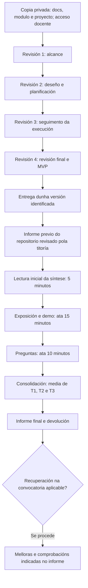

# Guía do proxecto

**Curso 2026–2027 · repo-proy**

Usa este repositorio como base do teu proxecto. `modulo/` reúne as regras
comúns; ti completas a documentación en `docs/` e a implementación en
`proyecto/`. A túa copia e a entrega son privadas.

## 1. Comezar cunha copia privada

1. En GitHub, usa **Use this template → Create a new repository** e escolle
   **Private**. A copia debe ser independente, non un fork público.
2. Engade a persoa titora como colaboradora e o profesorado do tribunal que
   solicite acceso. Os identificadores comunícanse pola canle institucional;
   non os escribas nos documentos.
3. Clona a túa copia privada no equipo de traballo.
4. Comproba con `git remote -v` que as subidas van á túa copia privada,
   especialmente se a creaches manualmente.
5. Completa `proyecto/README.md` e os apartados de `docs/`. Non cambies os
   materiais de `modulo/` para redefinir as condicións da entrega.

Non é necesario publicar o repositorio nin despregar a aplicación en Internet.

## 2. Estrutura

```text
README.md                 Entrada estable ás tres áreas
modulo/
  README.md               Índice dos materiais comúns
  programacion.md         Programación co currículo como anexo
  rubrica.md              Única rúbrica para alumnado e profesorado
  guia.md                 Instrucións e fluxo de traballo
  calendario.md           Franxas previstas, tempos e canle de convocatoria
  tribunal/
    hoja-individual.md    Modelo público en branco para cada membro do tribunal
    hoja-consolidacion.md Modelo público en branco de consolidación
docs/
  01-contexto.md          150 palabras
  02-alcance.md           150 palabras
  03-diseno.md            250 palabras
  04-recursos.md          150 palabras
  05-planificacion.md     150 palabras
  06-seguimento.md        100 palabras
  07-validacion.md        200 palabras
  08-conclusions.md       100 palabras
  sintese.md              Fonte do PDF de máximo dúas páxinas
  img/                   Fotografías/capturas JPG e gráficos SVG
  diagramas/             Fontes Mermaid cando non vaian no Markdown
proyecto/
  README.md               Instrucións técnicas: máximo 250 palabras
  src/                    Código fonte
  tests/                  Probas
  datos/                  Sementes ficticias e preparación do almacén
.gitignore               Saídas, datos locais, contornos e segredos excluídos
```

Retira os `.gitkeep` cando engadas contido. Podes adaptar a estrutura á
tecnoloxía elixida se o explicas en `proyecto/README.md`: unha disposición
equivalente e comprensible non se penaliza.

O README raíz e `modulo/` non computan no límite de palabras. As rutas desta
guía parten da raíz do repositorio; cada comando técnico debe indicar o
directorio desde o que se executa. Identifica na entrega a versión dos
materiais docentes aplicada: a túa copia non substitúe as regras comúns.

## 3. Documentación curta e visual

- Máximo **1.500 palabras** entre `proyecto/README.md` e os oito apartados
  de `docs/`, cos límites do esquema anterior.
- A síntese ten un máximo de dúas páxinas e non suma a esas 1.500 palabras.
- Markdown para textos; JPG para fotografías e capturas; SVG para diagramas
  e infografías. Os diagramas Mermaid conservarán a fonte editable, nun
  bloque Markdown ou nun arquivo `.mmd`. Non se esixe SVG duplicado se se
  visualizan correctamente.
- As preguntas orientadoras de `docs/` están en comentarios Markdown.
  Consúltaas no editor ou na vista de código e retíraas ao completar o
  apartado. As instrucións herdadas non computan.
- O texto de táboas computa. Imaxes, diagramas, código, datos ficticios e
  comandos executables non computan. Non se usará prosa incrustada neles
  nin anexos para eludir os límites.
- Enlaza as probas e os rexistros técnicos desde a documentación, sen
  reproducilos nin convertelos nunha memoria adicional.
- Un exceso de extensión sinalarase para corrección, sen desconto automático.
  A comunicación identifica a corrección necesaria e o prazo aplicable,
  conservando a referencia á entrega orixinal.

## 4. Construír unha versión concreta

Explica en `proyecto/README.md` como executar a versión entregada:

1. Identifica a etiqueta ou commit.
2. Prepara ferramentas e dependencias coas súas versións e os ficheiros de
   bloqueo dispoñibles no ecosistema.
3. Compila ou prepara a aplicación. Se é interpretada, chega con preparar
   o contorno e arrancar esa versión: non se obriga a crear un binario.
4. Prepara o almacén e carga datos ficticios.
5. Executa o percorrido esencial e reinicia a aplicación sen borrar os datos
   para comprobar a persistencia.

Escolle as ferramentas axeitadas ao alcance; non se prescribe linguaxe,
framework, provedor, Docker nin integración continua.

Na demo mostra a preparación e a execución desa versión. Podes descargar
dependencias antes, indicándoo. Non se esixe reinstalar todo o contorno
nin obter binarios idénticos bit a bit.

Se hai despregamento, identifica a versión e a súa relación co código.
Pode ser local; usar infraestrutura comercial non dá puntos adicionais.

## 5. Non versionar binarios nin datos de execución

- Non se entregarán executables precompilados, dependencias descargadas,
  paquetes de construción nin bases de datos locais no historial.
- Si se versionarán fontes, manifests, bloqueos de dependencias, scripts
  de construción, migracións e sementes de datos ficticios necesarios.
- Os JPG e SVG de documentación e o PDF da síntese son excepcións
  documentais, non artefactos executables.
- Ignora `proyecto/bin/`, `proyecto/build/`, `proyecto/dist/` e outras saídas
  de construción. Adapta `.gitignore` sen excluír fontes nin probas.
- A persistencia local poderá ir en `proyecto/datos/local/`, ignorado. Os datos
  iniciais deben poder rexenerarse desde os arquivos versionados.

## 6. Privacidade e seguridade

Non inclúas nomes persoais, correos, teléfonos, expedientes, sinaturas,
credenciais, rutas persoais nin información empresarial confidencial.
Revisa tamén imaxes, diagramas, metadatos e saídas de consola.

Usa un código de proxecto non identificativo. Non copies as listaxes de
colaboradores aos documentos. Un repositorio privado pode conservar
metadatos de autoría de Git: non é anónimo nin debe facerse público.

Nos exemplos de configuración usa valores ficticios. Se filtras un segredo,
comunícao e revógao: borralo do último arquivo non o elimina do historial.

## 7. Entregar e defender

Antes da entrega:

- Autoavalía as evidencias coa [rúbrica](rubrica.md).
- Comunica pola aula virtual a versión `proy-entrega-v1`, no prazo da convocatoria.
- Exporta `docs/sintese.md` a `docs/sintese.pdf`, comproba o máximo de dúas
  páxinas e leva esa mesma versión impresa, co número de copias indicado.
- Prepara exposición e demo nun máximo conxunto de 15 minutos e ata
  10 minutos de preguntas. A lectura inicial da síntese ten cinco minutos
  propios. Consulta o [calendario](calendario.md).

O [fluxo seguinte](#fluxo-de-traballo) explica as revisións, a presentación
e a corrección. As follas do tribunal son modelos en branco: non debes
imprimilas nin gardar valoracións docentes na túa entrega.

<a id="fluxo-de-traballo"></a>

## 8. Fluxo de traballo, seguimento e corrección

O diagrama resume o proceso; a rúbrica define a puntuación.



### 8.1. Seguimento continuo

O alumnado traballa no repositorio privado co acompañamento principal da
titoría. As revisións orientan as melloras, non crean notas adicionais.

| Etiqueta                                | Finalidade                                |
| --------------------------------------- | ----------------------------------------- |
| `proy-revision-01`, `proy-revision-02`… | Solicitar revisión dunha versión concreta |
| `proy-entrega-v1`                       | Versión presentada ao tribunal            |
| `proy-recuperacion-v1`                  | Versión de mellora cando proceda          |

Cada etiqueta resolverase a un commit e non se moverá nin sobrescribirá.
Se se precisa outra versión, crearase outra etiqueta.

Planifícanse **catro revisións formais**, sen cualificacións adicionais:

| Revisión                   | Etiqueta inicial   | Obxecto da revisión                                                                                                                                        |
| -------------------------- | ------------------ | ---------------------------------------------------------------------------------------------------------------------------------------------------------- |
| 1. Alcance                 | `proy-revision-01` | Necesidade, destinatarios, obxectivo, percorrido esencial, límites e viabilidade. Utilízase a [ficha de alcance](../docs/02-alcance.md) xunto co contexto. |
| 2. Deseño e planificación  | `proy-revision-02` | Arquitectura, almacén e modelo de datos, recursos, tarefas, dependencias e riscos.                                                                         |
| 3. Seguimento da execución | `proy-revision-03` | Avance respecto do plan, decisións, dificultades, cambios e comprobacións dispoñibles.                                                                     |
| 4. Revisión final e MVP    | `proy-revision-04` | Preparación e execución da versión, datos e persistencia, validación, documentación e preparación da entrega.                                              |

As datas acordaranse coa titoría. Son fitos de acompañamento, non un límite
ás consultas breves nin catro entregas puntuables. O número de revisións,
incidencias ou commits non recibe puntos por si mesmo. A falta dunha revisión
non introduce un cero nin un suspenso automático.

Se hai que presentar unha nova versión para a mesma revisión, créase, por
exemplo, `proy-revision-02-v2`, sen mover a etiqueta anterior. O resultado
da revisión e as melloras indicadas quedan rexistrados.

### 8.2. Preparación previa á sesión

1. O alumnado comunica a versión de entrega pola canle institucional.
2. Revísase esa versión e elabórase un **informe previo do repositorio**,
   cunha proposta de ata **6 puntos** en R1–R6, evidencias localizables e
   límites da análise.
3. A titoría revisa o informe antes de facilitalo ao tribunal. A revisión
   pode apoiarse en ferramentas automatizadas validadas; o non comprobado
   por elas revísase manualmente coa mesma rúbrica.
4. Antes da sesión, o tribunal recibe a rúbrica aplicable e o informe previo.
   Este non é a cualificación final e non puntúa por anticipado exposición
   nin demo.
5. Prepáranse follas de valoración en branco para o profesorado.

Os informes individuais e as correspondencias de códigos son privados.
Non se incorporan ao repositorio público nin se envían automaticamente.

### 8.3. Sesión de presentación

O [calendario](calendario.md) recolle as franxas previstas e a distribución
dos tempos. A convocatoria na aula virtual confirma data e horas e comunica
a asignación individual, a aula e o prazo de entrega. Os datos persoais
non se incorporan ao calendario público.

O tribunal dedica os primeiros **cinco minutos** á síntese impresa, a mesma
versión do PDF entregado. P1 valora a síntese, non o soporte de papel.
A convocatoria indica o número de copias; non se esixen impresións
adicionais sen comunicalo nin se pide imprimir o informe docente.

Despois realízanse **ata 15 minutos de exposición e demo** e **ata 10 de
preguntas**. Exposición e demo puntúan por separado, pero comparten tempo.
As franxas dunha hora non amplían estes límites.

O profesorado utiliza a [folla individual do tribunal](tribunal/hoja-individual.md)
para refrendar ou propoñer correccións á valoración do repositorio e rexistrar
P1, P2 e D1. A [folla de consolidación](tribunal/hoja-consolidacion.md)
permite consolidar e fundamentar a decisión.

### 8.4. Consolidación e arquivo

Cada un dos **tres membros puntuadores**, T1, T2 e T3, entrega a súa folla.
A titoría coordina a sesión e consolida os resultados, pero **non puntúa**.
O informe automatizado tampouco conta como outra valoración.

Calcúlase a media dos tres por cada un dos nove indicadores, sen convertela
a un nivel discreto. Non se redondean medias nin subtotais: só o total,
ao enteiro máis próximo co medio punto cara arriba. A
[rúbrica](rubrica.md) detalla o cálculo e o aprobado, sen mínimos por bloque.
Os 43 CA serven para comprobar cobertura, non son 43 notas adicionais.
Se falta unha valoración, resólvese antes de pechar a nota: non vale cero
nin se substitúe pola do tutor ou a automatizada.

As puntuacións consolídanse nunha folla de cálculo privada. Consérvanse as
follas orixinais, os cambios xustificados e o informe final nun **arquivo
dixital privado**, fóra do repositorio público e da entrega do estudante.
Os modelos Markdown poden exportarse a PDF; o papel é só apoio temporal.
Os tres membros validan polo procedemento institucional: un ficheiro
editable non substitúe esa validación nin a acta oficial.

### 8.5. Informe final e mellora

O informe final é posterior á sesión. Recollerá a versión avaliada, evidencias,
as tres valoracións docentes, media por indicador, suma 6 + 2 + 2 sen
redondeos intermedios, nota oficial e melloras prioritarias.

Se procede recuperación, indicará as evidencias que se deben mellorar e as
comprobacións ou actuacións que cómpre repetir, conservando o válido na medida
permitida polo réxime aplicable. Non crea convocatoria nin segunda defensa
automática: o calendario debe autorizar esas actuacións.

A devolución individual revisarase antes de entregala e gardarase no espazo
docente privado. O informe previo e o informe final son momentos distintos.
