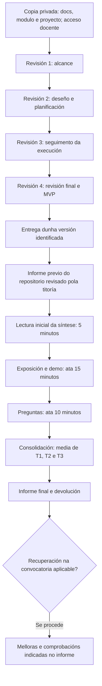

# Guía da plantilla de Proxecto

**Curso 2026–2027 · repo-proy**

Este repositorio público reúne a plantilla e os materiais comúns. A programación,
a rúbrica e as instrucións non conteñen identidades persoais nin valoracións
individuais. As entregas do alumnado serán privadas.

## 1. Comezar cunha copia privada

1. Crea unha copia **privada e independente** da plantilla, non un fork público.
   Se se habilita a función de plantilla na plataforma, utilízaa escollendo
   visibilidade privada.
2. Engade a persoa titora como colaboradora e habilita o acceso ao profesorado
   do tribunal que participe na revisión. Os identificadores de acceso
   comunicaranse pola canle institucional, non se incorporan á plantilla.
3. Clona a túa copia privada no equipo de traballo.
4. Revisa os arquivos herdados antes do primeiro envío. Se fas a copia manual,
   comproba con `git remote -v` que o destino de subida é a túa copia privada,
   non o repositorio público docente.
5. Completa `proyecto/README.md` e os apartados de documentación. Non modifiques a
   programación nin a rúbrica para redefinir as condicións da entrega.

Non publiques un repositorio de estudante para facilitar a avaliación. Tampouco
é necesario publicar a aplicación en Internet.

## 2. Estrutura

```text
README.md                 Entrada estable ás tres áreas
modulo/
  README.md               Índice dos materiais comúns
  programacion.md         Programación co currículo como anexo
  rubrica.md              Única rúbrica para alumnado e profesorado
  guia.md                 Instrucións e fluxo de traballo
  calendario.md           Franxas previstas, tempos e canle de convocatoria
  tribunal/
    hoja-individual.md    Modelo público en branco para cada membro do tribunal
    hoja-consolidacion.md Modelo público en branco de consolidación
docs/
  01-contexto.md          150 palabras
  02-alcance.md           150 palabras
  03-diseno.md            250 palabras
  04-recursos.md          150 palabras
  05-planificacion.md     150 palabras
  06-seguimento.md        100 palabras
  07-validacion.md        200 palabras
  08-conclusions.md       100 palabras
  sintese.md              Fonte do PDF de máximo dúas páxinas
  img/                   Fotografías/capturas JPG e gráficos SVG
  diagramas/             Fontes Mermaid cando non vaian no Markdown
proyecto/
  README.md               Instrucións técnicas: máximo 250 palabras
  src/                    Código fonte
  tests/                  Probas
  datos/                  Sementes ficticias e preparación do almacén
.gitignore               Saídas, datos locais, contornos e segredos excluídos
```

Os `.gitkeep` só conservan directorios baleiros; poden retirarse ao engadir
contido. Poderá adaptarse a estrutura ás convencións dunha tecnoloxía
se se explica en `proyecto/README.md`. Non se penaliza por si mesma outra disposición
equivalente e comprensible.

`modulo/` contén materiais docentes comúns e modelos en branco:
non computan no límite de palabras, igual que o README raíz. As rutas
`docs/`, `proyecto/src/`, `proyecto/tests/`, `proyecto/datos/` e
`proyecto/README.md` son relativas á raíz do repositorio.
Os comandos técnicos deben indicar o seu directorio de execución.
As copias do estudante non substitúen a versión docente aplicable; a entrega
debe identificar tamén a versión da plantilla ou das regras recibidas.

## 3. Documentación curta e visual

- Máximo **1.500 palabras** entre `proyecto/README.md` e os oito apartados de `docs/`,
  cos límites parciais anteriores.
- A síntese é independente: máximo dúas páxinas, sen engadir unha memoria nova.
- Markdown para textos; JPG para fotografías e capturas; SVG para diagramas
  e infografías. Os diagramas Mermaid conservarán a fonte editable, nun
  bloque Markdown ou nun arquivo `.mmd`. Non se esixe SVG duplicado se se
  visualizan correctamente.
- As indicacións e preguntas herdadas da plantilla non computan; retíraas
  cando completes o apartado.
- Os arquivos de `docs/` inclúen preguntas orientadoras en comentarios
  Markdown: consúltaas no editor ou na vista de código do arquivo, xa que
  non aparecen na vista renderizada. Non forman parte da resposta final.
- O texto de táboas computa. Imaxes, diagramas, código, datos ficticios e
  comandos executables non computan. Non se usará prosa incrustada neles
  nin anexos para eludir os límites.
- A documentación debe remitir ás evidencias, non reproducir probas,
  rexistros ou explicacións enteiras.
- As probas e os rexistros técnicos poden vivir en arquivos apropiados;
  non son unha memoria narrativa adicional.
- Un exceso de extensión sinalarase para corrección, sen desconto automático.
  A comunicación identifica a corrección necesaria e o prazo aplicable,
  conservando a referencia á entrega orixinal.

## 4. Construír unha versión concreta

O proxecto debe explicar como obter unha aplicación executable desde o código
da versión entregada:

1. Identificar a etiqueta ou commit que se vai avaliar.
2. Preparar as ferramentas e dependencias, con versións identificadas e
   ficheiros de bloqueo cando os proporcione o ecosistema.
3. Compilar ou preparar o executable, paquete ou servizo. Nunha aplicación
   interpretada, preparar o contorno e arrancar esa versión é o equivalente:
   non se obriga a fabricar un binario.
4. Preparar o almacén e cargar datos ficticios.
5. Executar o percorrido esencial, comprobar o almacenamento e reiniciar
   a aplicación para comprobar a persistencia sen borrar os datos.

Os comandos concretos elíxeos cada proxecto. Non se prescribe Docker, unha
linguaxe, un framework, un provedor nin unha integración continua.

Durante a demo mostrarase a construción ou preparación da versión avaliada
e a súa execución. A descarga inicial de dependencias pode prepararse antes
para axustarse ao tempo dispoñible; o proceso debe declaralo, non ocultalo.
Non se esixe compilar un sistema completo desde cero nin reproducibilidade
binaria bit a bit.

Se a demo inclúe un despregamento, identificarase a versión despregada e
como se obtén desde o código. Pode ser local. Non é unha bonificación por
utilizar infraestrutura comercial.

## 5. Non versionar binarios nin datos de execución

- Non se entregarán executables precompilados, dependencias descargadas,
  paquetes de construción nin bases de datos locais no historial.
- Si se versionarán fontes, manifests, bloqueos de dependencias, scripts
  de construción, migracións e sementes de datos ficticios necesarios.
- Os JPG e SVG de documentación e o PDF da síntese son excepcións
  documentais, non artefactos executables.
- As saídas locais de `proyecto/bin/`, `proyecto/build/`, `proyecto/dist/`
  e equivalentes quedarán
  ignoradas. Adapta `.gitignore` sen excluír fontes nin probas necesarias.
- A persistencia local poderá ir en `proyecto/datos/local/`, ignorado. Os datos
  iniciais deben poder rexenerarse desde os arquivos versionados.

## 6. Privacidade e seguridade

A documentación entregada e a pública non incluirán nomes persoais, correos,
teléfonos, expedientes, sinaturas, credenciais, rutas do equipo con nomes de
usuario nin información empresarial confidencial. As imaxes e os diagramas
deben cumprir a mesma regra; revisa tamén metadatos e saídas de consola.

Usa un código de proxecto non identificativo se necesitas unha referencia.
Non copies listaxes de colaboradores aos documentos. Os permisos de acceso
e os rexistros da plataforma son distintos do contido documental; un
repositorio privado pode conter metadatos de autoría de Git, polo que non
se debe presentar como anónimo nin facelo público.

Os exemplos de configuración só conterán valores ficticios. Se se filtra un
segredo, comunícao e revógao: borralo do último arquivo non o elimina do
historial.

## 7. Entregar e defender

O [fluxo de traballo](#fluxo-de-traballo) explica as revisións e a sesión.
As revisións usan etiquetas `proy-revision-01`, `proy-revision-02`…;
a entrega, `proy-entrega-v1`. Non movas nin sobrescribas etiquetas.

Haberá catro revisións formais coa titoría: **alcance; deseño e planificación;
seguimento da execución; revisión final e MVP**. Non son catro notas nin
un límite ás consultas. A primeira usa a ficha de `docs/02-alcance.md`.
Para unha segunda versión da mesma revisión pode usarse o sufixo `-v2`,
sen substituír a etiqueta inicial.

- Identifica unha versión estable mediante etiqueta ou commit e comunícaa
  pola aula virtual, no prazo indicado na convocatoria.
- Exporta `docs/sintese.md` a `docs/sintese.pdf`, comproba o máximo de dúas
  páxinas e entrega esa mesma versión impresa. É o único documento impreso.
- Prepara exposición e demo dentro dun máximo conxunto de 15 minutos,
  seguidas de ata 10 minutos de preguntas.
- Os primeiros cinco minutos da franxa resérvanse á lectura da síntese
  impresa polo tribunal, antes da exposición. A convocatoria indica o número
  de copias. Consulta o [calendario](calendario.md).
- Consulta a [rúbrica](rubrica.md) para autoavaliar as evidencias.

A plantilla non inclúe notas, informes individuais nin credenciais docentes.
A revisión pode apoiarse en ferramentas automatizadas validadas, con
comprobación docente e revisión manual dos aspectos non comprobados.

A [folla de consolidación](tribunal/hoja-consolidacion.md) é un modelo público en branco:
o alumnado pode coñecer como se rexistrará a valoración. As copias cubertas,
as propostas automatizadas e as valoracións do tribunal gardaranse nun
espazo docente privado fóra do repositorio público e da entrega do estudante.

A [folla individual do tribunal](tribunal/hoja-individual.md) é a versión de recollida
individual para papel. Non é a síntese do alumnado nin debe imprimila este.
O arquivo docente definitivo é dixital; o papel é só apoio temporal.

Puntúan tres membros do tribunal; a persoa titora está na presentación,
pero non puntúa. A nota procede da media dos tres por indicador e do
redondeo só do total ao enteiro máis próximo, co medio punto cara arriba,
segundo a rúbrica.

<a id="fluxo-de-traballo"></a>

## 8. Fluxo de traballo, seguimento e corrección

O diagrama resume o proceso. Os apartados seguintes concretan as actuacións
sen engadir indicadores nin puntuacións á rúbrica.



### 8.1. Seguimento continuo

O alumnado traballa no repositorio privado co acompañamento principal da
titoría. As revisións orientan as melloras, non crean notas adicionais.

| Etiqueta                                | Finalidade                                |
| --------------------------------------- | ----------------------------------------- |
| `proy-revision-01`, `proy-revision-02`… | Solicitar revisión dunha versión concreta |
| `proy-entrega-v1`                       | Versión presentada ao tribunal            |
| `proy-recuperacion-v1`                  | Versión de mellora cando proceda          |

Cada etiqueta resolverase a un commit e non se moverá nin sobrescribirá.
Se se precisa outra versión, crearase outra etiqueta.

Planifícanse **catro revisións formais**, sen cualificacións adicionais:

| Revisión                   | Etiqueta inicial   | Obxecto da revisión                                                                                                                                        |
| -------------------------- | ------------------ | ---------------------------------------------------------------------------------------------------------------------------------------------------------- |
| 1. Alcance                 | `proy-revision-01` | Necesidade, destinatarios, obxectivo, percorrido esencial, límites e viabilidade. Utilízase a [ficha de alcance](../docs/02-alcance.md) xunto co contexto. |
| 2. Deseño e planificación  | `proy-revision-02` | Arquitectura, almacén e modelo de datos, recursos, tarefas, dependencias e riscos.                                                                         |
| 3. Seguimento da execución | `proy-revision-03` | Avance respecto do plan, decisións, dificultades, cambios e comprobacións dispoñibles.                                                                     |
| 4. Revisión final e MVP    | `proy-revision-04` | Preparación e execución da versión, datos e persistencia, validación, documentación e preparación da entrega.                                              |

As datas acordaranse coa titoría. Son fitos de acompañamento, non un límite
ás consultas breves nin catro entregas puntuables. O número de revisións,
incidencias ou commits non recibe puntos por si mesmo. A falta dunha revisión
non introduce un cero nin un suspenso automático.

Se hai que presentar unha nova versión para a mesma revisión, créase, por
exemplo, `proy-revision-02-v2`, sen mover a etiqueta anterior. O resultado
da revisión e as melloras indicadas quedan rexistrados.

### 8.2. Preparación previa á sesión

1. O alumnado comunica a versión de entrega pola canle institucional.
2. Revísase esa versión e elabórase un **informe previo do repositorio**,
   cunha proposta de ata **6 puntos** en R1–R6, evidencias localizables e
   límites da análise.
3. A titoría revisa o informe antes de facilitalo ao tribunal. A revisión
   pode apoiarse en ferramentas automatizadas validadas; o non comprobado
   por elas revísase manualmente coa mesma rúbrica.
4. Antes da sesión, o tribunal recibe a rúbrica aplicable e o informe previo.
   Este non é a cualificación final e non puntúa por anticipado exposición
   nin demo.
5. Prepáranse follas de valoración en branco para o profesorado.

Os informes individuais e as correspondencias de códigos son privados,
non se incorporan ao repositorio público nin se envían automaticamente.

### 8.3. Sesión de presentación

O [calendario](calendario.md) recolle as franxas previstas e a distribución
dos tempos. A convocatoria na aula virtual confirma data e horas e comunica
a asignación individual, a aula e o prazo de entrega. Os datos persoais
non se incorporan ao calendario público.

O alumnado trae a síntese de máximo dúas páxinas impresa e entrégaa ao
tribunal ao inicio. É a mesma versión do PDF incluído na entrega.

Resérvanse os **primeiros cinco minutos** á súa lectura. Esta precede a
exposición e non consume o seu tempo. P1 valora a síntese, non o soporte
de papel. A convocatoria indica o número de copias; non se presume unha
copia por docente nin unha obriga de impresión adicional sen comunicala.
Non se pide ao alumnado imprimir o informe de corrección.

A exposición e a demo comparten un máximo de **15 minutos**, seguidos de
**ata 10 minutos de preguntas**. Exposición e demo teñen indicadores
diferentes, pero non quendas de tempo adicionais. A lectura inicial queda
fóra deses quince minutos. As franxas dunha hora non implican unha hora de
exposición por proxecto.

O profesorado utiliza a [folla individual do tribunal](tribunal/hoja-individual.md)
para refrendar ou propoñer correccións á valoración do repositorio e rexistrar
P1, P2 e D1. A [folla de consolidación](tribunal/hoja-consolidacion.md)
permite consolidar e fundamentar a decisión.

### 8.4. Consolidación e arquivo

As puntuacións recóllense nas follas individuais e consolídanse nunha folla
de cálculo privada. Os modelos Markdown poden exportarse a PDF.
O **arquivo definitivo é dixital**: consérvanse os rexistros individuais,
a consolidación e o informe final nun espazo docente restrinxido.

O papel, se se utiliza durante a sesión, é apoio temporal. Non se esixe
arquivo permanente en papel. A validación dos tres membros realízase polo
procedemento institucional aplicable e non se substitúe pola mera existencia
dun ficheiro editable. Este rexistro non substitúe a acta oficial.

Cada docente entrega a súa folla á persoa responsable. Consérvanse as
valoracións orixinais e xustifícanse os cambios.

O tribunal puntuador está formado por **tres membros**, identificados nos
rexistros como T1, T2 e T3. A persoa titora está na presentación, coordina
o proceso e achega o seguimento e o informe previo, pero **non puntúa nin
entra na media**. A proposta automatizada tampouco conta como cuarta valoración.

Cada membro revisa e puntúa os nove indicadores coa mesma escala. Para cada
indicador i, calcúlase a **media aritmética das tres puntuacións**:

`media_i = (puntos_T1_i + puntos_T2_i + puntos_T3_i) / 3`

Non se crean 43 notas novas por CA: manteñen a súa comprobación de cobertura.
Non se redondean as medias nin se obriga a que encaixen nun nivel discreto
da escala. Unha casilla non revisada non vale cero; se falta unha das tres
valoracións, resólvese a incidencia antes de pechar a nota, sen substituíla
pola do tutor ou pola automatizada.

O total S é a suma das nove medias, conservando precisión ata o final.
A cualificación numérica oficial obtense redondeando **ao enteiro máis
próximo, co medio punto cara arriba**, non mediante `ceil` nin redondeo
bancario. Para o rango numérico 1–10:

`nota = max(1, floor(S + 0.5))`

Así, 4,49 → 4; 4,50 → 5; 7,49 → 7; 7,50 → 8; 0 → 1.
O aprobado determínase pola **nota oficial igual ou superior a 5**, sen
mínimos por bloque. As situacións administrativas sen cualificación numérica
tramítanse polo procedemento do centro.

### 8.5. Informe final e mellora

O informe final é posterior á sesión. Recollerá a versión avaliada, evidencias,
as tres valoracións docentes, media por indicador, suma 6 + 2 + 2 sen
redondeos intermedios, nota oficial e melloras prioritarias.

Se procede recuperación, indicará as evidencias que se deben mellorar e as
comprobacións ou actuacións que cómpre repetir, conservando o válido na medida
permitida polo réxime aplicable. Non crea convocatoria nin segunda defensa
automática: o calendario debe autorizar esas actuacións.

A devolución individual revisarase antes de entregala e gardarase no espazo
docente privado. O informe previo e o informe final son momentos distintos.
